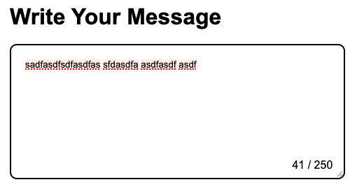
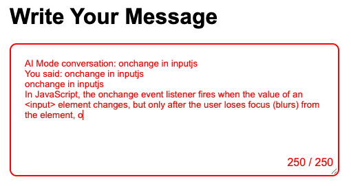

# Restricted Textarea

A textarea with a live character counter and a maximum character limit. As the user types, the count updates in real time. When the limit is reached, the textarea stops accepting input and the border and counter turn red.

This project is based on the [Restricted Textarea](https://roadmap.sh/projects/restricted-textarea) challenge from roadmap.sh.

## Preview

| Default state | Limit reached |
| :-----------: | :-----------: |
|  |  |

## Features

- Live character count that updates on every keystroke
- Maximum limit of 250 characters
- Input is blocked once the limit is reached
- Red border and red counter text when the limit is hit
- Plain HTML, CSS, and JavaScript with no dependencies

## Tech Stack

- HTML5
- CSS3
- Vanilla JavaScript

## Project Structure

```
Restricted-Textarea/
├── .vscode/
├── src/
│   ├── index.html
│   ├── style.css
│   └── script.js
├── preview/
│   ├── default.png
│   └── limit-reached.png
└── README.md
```

## Getting Started

1. Clone the repository:

   ```bash
   git clone https://github.com/KunalGuhagarkar/Restricted-Textarea.git
   ```

2. Move into the project folder:

   ```bash
   cd Restricted-Textarea
   ```

3. Open `src/index.html` in your browser. No build step or server is needed.

## How It Works

- The `maxlength="250"` attribute on the `<textarea>` stops the user from typing past the limit.
- An `input` event listener in `script.js` reads the current text length and updates the counter (`0 / 250`).
- When the length reaches exactly 250, the `active-border` and `active-color` classes are added to the textarea and the counter, turning them red. They are removed as soon as the user deletes characters.

## What I Practiced

- Manipulating DOM elements with JavaScript
- Handling user input events
- Giving users real-time visual feedback
- Toggling CSS classes based on state

## Links

- Repository: https://github.com/KunalGuhagarkar/Restricted-Textarea
- Challenge page: https://roadmap.sh/projects/restricted-textarea

## Author

**Kunal Guhagarkar** - [@KunalGuhagarkar](https://github.com/KunalGuhagarkar)